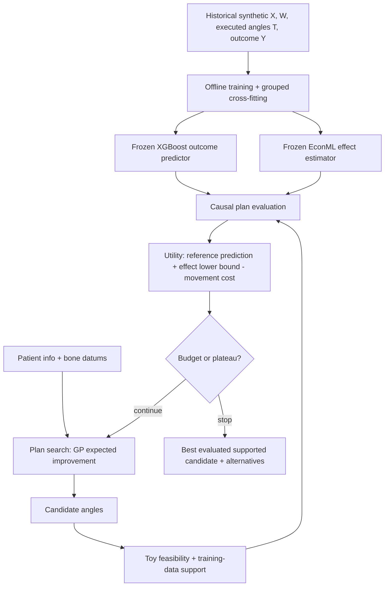

# Plan ML POC

An educational Python/Jupyter prototype of patient-specific surgical-plan **training, evaluation and search mechanics**. Every case, outcome, constraint and result is synthetic. We do not have actual outcome data, and this repository supports no clinical conclusions.

The starting example is TKA with **three continuous executed angles** (femoral varus, tibial varus and tibial slope), a fixed implant family and a synthetic 12-month FJS-like outcome. It follows the supplied plan-generation diagram and the v2 project conversations. THA, full CT encoders, mesh placement, resection generation, implant selection and real biomechanics remain explicit extension points.

## Run it

Python 3.11 and [uv](https://docs.astral.sh/uv/) are recommended. The repository includes a dependency lockfile. On macOS, XGBoost also needs OpenMP (`brew install libomp`). Python dependencies stay in the project's `.venv`.

```bash
cd ~/kinomatic/plan-ml-poc
uv sync --frozen
uv run plan-ml-poc --rows 3000 --budget 35
uv run jupyter lab
```

Open the notebooks in order:

| Notebook | What you learn |
|---|---|
| `01_data_and_causal_question.ipynb` | X/W/T/Y roles, invented observational data, grouped holdout, oracle |
| `02_train_and_validate.ipynb` | XGBoost outcome prediction, EconML cross-fitting, continuous contrasts and intervals |
| `03_inference_and_plan_search.ipynb` | Frozen inference, support checks, utility, GP Bayesian optimization, random baseline |
| `04_assumptions_and_failure_modes.ipynb` | Hidden confounding and a path toward actual outcome data |

The notebooks include executed outputs for review. **Restart Kernel → Run All** reproduces the full example. Notebook 03 loads the model saved by 02; it trains a synthetic bundle if run alone. To deliberately refit after editing training code, rerun notebook 02.

### Saved artifacts and inference without retraining

The demo writes `artifacts/demo/`: fitted models, version/schema metadata, a synthetic patient, a run summary, ranked alternatives and every evaluated candidate. Notebook artifacts live in `artifacts/notebooks/`.

```bash
uv run plan-ml-poc --load-models artifacts/demo --budget 35 --output artifacts/inference
```

Only load trusted `models.joblib` files; Python model serialization can execute code. Version metadata records the tested dependencies. Refit when changing versions or feature definitions.

## How the diagram becomes code



| File | Responsibility |
|---|---|
| `src/plan_ml_poc/schema.py` | Named features, units, fixed scaling, teaching bounds and reference |
| `synthetic.py` | Invented assignment/outcome process and synthetic-only oracle |
| `training.py` | Patient-level split, XGBoost, EconML LinearDML and metrics |
| `support.py` | Training-only joint patient/context/treatment proximity check |
| `evaluation.py` | Toy feasibility, abstention, contrasts, intervals and objective |
| `search.py` | Readable GP + Expected Improvement loop and stopping rules |
| `persistence.py`, `demo.py` | Save/load, provenance and reproducible command-line workflow |

## Key modeling choices

- **EconML LinearDML with quadratic treatment features** permits curved angle responses and pairwise interactions. The final effect coefficients vary linearly with patient features. This deliberately simple model matches the invented response family. Default continuous-treatment linear effects alone would often send an optimizer toward a boundary. See [EconML LinearDML](https://www.pywhy.org/EconML/_autosummary/econml.dml.LinearDML.html) for the underlying API.
- **XGBoost is associational.** We show candidate outcome predictions separately. A reference prediction plus an EconML contrast is a hybrid display heuristic, not automatically an identified absolute causal outcome.
- **The search ranks causal lower-bound improvement minus movement cost.** Adding the same reference prediction to every candidate does not change their order. We never add the candidate's full outcome prediction to its causal effect and double-count benefit.
- **Models train offline.** A separate Gaussian process learns the utility surface during search; the fitted outcome and causal models do not change. The implementation uses [scikit-learn Gaussian processes](https://scikit-learn.org/stable/modules/gaussian_process.html), with explicit Expected Improvement in `search.py`.
- **Unsupported comparisons abstain.** The reference and candidate must pass a joint nearest-neighbor/range heuristic. This is useful plumbing, not proof of causal overlap. Toy feasibility rules are not validated clinical or physical constraints.
- **Intervals are pointwise conditional-effect intervals.** They are neither individual outcome ranges nor selection-adjusted guarantees after optimization. DML is not an automatic guarantee of double robustness.

Read [the modeling notes](docs/modeling.md) for the estimand, assumptions and extension points, and [the data contract](docs/data_contract.md) before collecting or importing actual cases.

## Verification

```bash
uv run pytest -q
uv run ruff check src tests scripts
uv run python scripts/execute_notebooks.py
```

The tests check grouped holdouts, reproducible synthetic data/search, contrast identities, a loose synthetic recovery check, abstention, toy constraints, budget handling and persistence. They do not establish causal identification or clinical utility. The notebook runner executes clean kernels and retains outputs.
